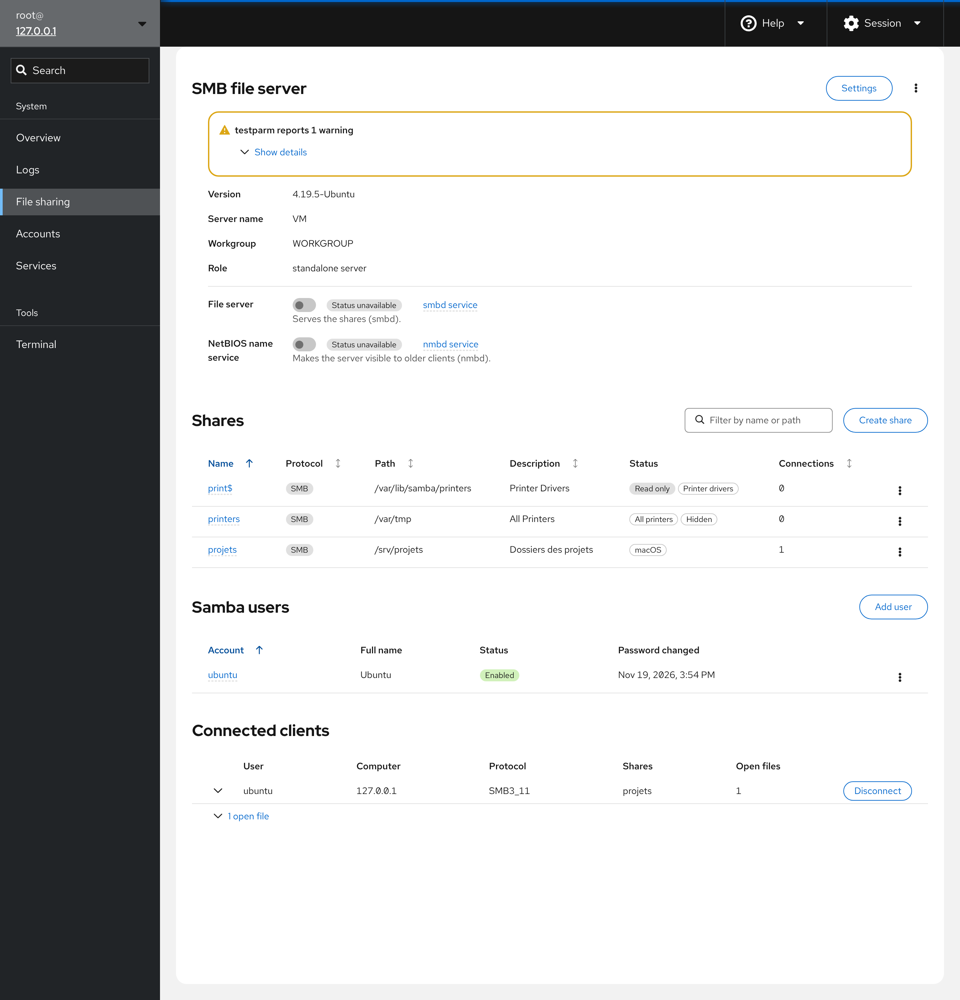
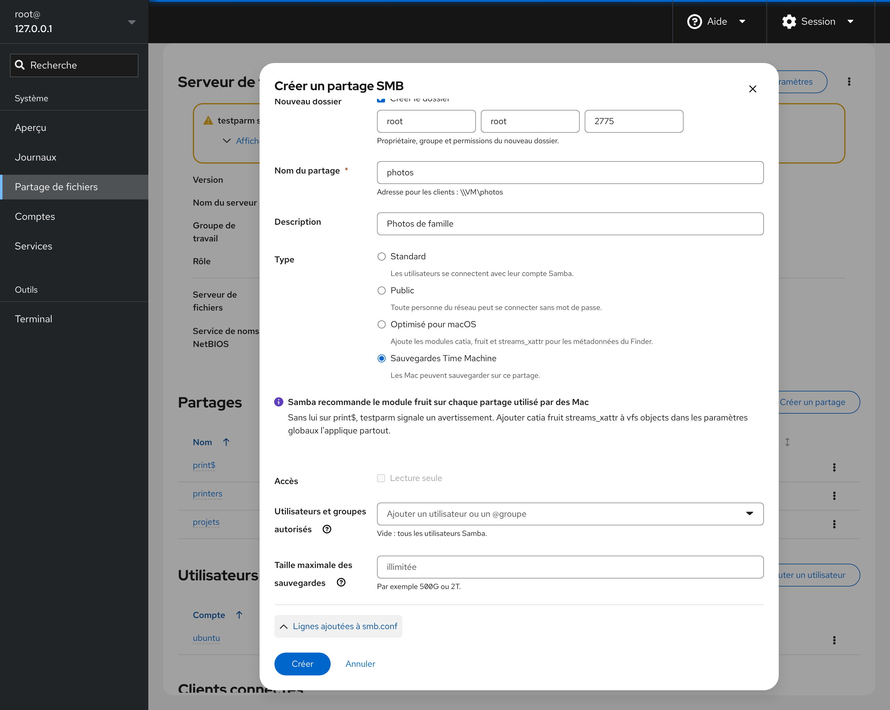
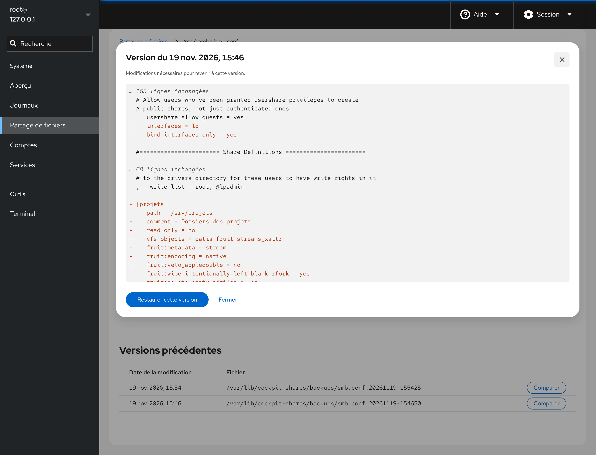

# Cockpit Shares

A [Cockpit](https://cockpit-project.org/) page to manage file shares. The first
version manages SMB with Samba; the code is organized in "providers" so that
other protocols (NFS, ...) can be added later.



## Features

**Samba server**
- version, NetBIOS name, workgroup, server role;
- `smbd`, `nmbd`, `winbind` and `wsdd` systemd units (start, enable, link to
  the Cockpit Services page); a restart is offered when a setting that is only
  read at startup changes;
- installs Samba with the Cockpit install dialog when it is missing;
- opens the `samba` service in firewalld (Cockpit's own component);
- shows the `testparm` diagnostics of the current configuration.

**Shares**
- list with filter, status, guest access and number of connections;
- guided creation: directory (created with owner, group and mode when
  needed), Standard, Public, macOS (`catia fruit streams_xattr`) and
  Time Machine presets, preview of the lines written;
- details page: Windows and macOS/Linux addresses to copy, directory checks
  (existence, owner, mode, SELinux label with a fix based on
  `semanage fcontext` + `restorecon`, `samba_enable_home_dirs` boolean),
  General, Access and Permissions forms, VFS modules (order, documented
  options, presets for `recycle`, `full_audit`, `shadow_copy2` and `fruit`),
  connected clients;
- enable, disable, rename, duplicate, delete;
- special sections `[homes]`, `[printers]` and `[print$]`;
- shares defined outside `smb.conf` (included files, registry) are shown read
  only.

**Every parameter**
- catalog generated from the Samba 4.25.1 documentation sources: 550
  `smb.conf` parameters (type, scope, accepted values, synonyms, inverted
  synonyms such as `writeable`, default value, documentation) and 177 options
  of 49 VFS modules;
- per section editor (global or share): parameters set in the section, or
  every parameter with the inherited or default value that really applies
  (`testparm -v` of the installed Samba version), search, categories, adding
  any parameter or `module:option`, reset to the default;
- typed editors: booleans, value lists, octal modes (shown as `rwxr-x---`),
  sizes, users and `@groups` with suggestions, paths.

`smb.conf` is never edited as text: every change goes through the forms.

**Samba users**: add from the system accounts, set password, enable, disable,
remove (with a link to the Cockpit Accounts page).

**Connected clients** (`smbstatus`): sessions, protocol, encryption, shares in
use, open files, disconnect one client or every client of a share.

**History of changes**: the versions saved before each change can be compared
with the current configuration and restored.

## How changes are applied

Every change follows the same path:

1. it is applied to an in-memory copy of the file; the parser keeps everything
   it does not change byte for byte (comments, order, continuation lines, key
   spelling, indentation style);
2. the resulting text is validated by `testparm` on its standard input before
   anything is written; a configuration rejected by `testparm` is not saved;
3. a copy of the current file is stored in `/var/lib/cockpit-shares/backups/`
   (the last 20 versions are kept, see "History of changes");
4. the file is replaced atomically, and the write is refused when the file
   changed on disk in the meantime;
5. `smbcontrol all reload-config` applies the configuration.

The parser follows Samba's own rules (`lib/util/tini.c`,
`lib/param/loadparm.c`): `#` and `;` comments only at the start of a line,
`\` continuation lines, parameter and section names compared ignoring case and
whitespace, `[global]` and `[globals]`, parameters before the first section
belong to `[global]`, the last occurrence wins. A unit test compares the
parser's reading with `testparm` on several files.

## Installing on Debian or Ubuntu

Download `cockpit-shares_VERSION_all.deb` and install it with apt, which also
pulls the dependencies:

```bash
sudo apt install ./cockpit-shares_0.1.0_all.deb
```

The package contains the prebuilt page: Node.js and npm are not needed on the
machine running Cockpit. Build it with:

```bash
make deb
```

## Building and installing

Build dependencies: `make`, `gettext`, Node.js and npm (Node.js 22.18 or newer
for the unit tests, which run TypeScript directly).

```bash
make
```

```bash
sudo make install PREFIX=/usr
```

For development, without installing anything system wide:

```bash
make devel-install
```

then run `make` (or `make watch`) and reload the page in Cockpit.

Packaging: `make deb` (Debian, Ubuntu), `make rpm` (Fedora, RHEL, openSUSE)
and `packaging/arch/PKGBUILD.in` (Arch Linux).

## Tests

```bash
make unit-check
```

```bash
make typecheck
```

```bash
npm run eslint
```

`test/e2e/run.cjs` drives the page in a running Cockpit with Playwright and
checks `/etc/samba/smb.conf` after each action. It changes the Samba
configuration of the machine: only run it on a test system.

## Translations

The user interface strings are written in English and translated to French in
`po/fr.po`. After changing strings:

```bash
make po/shares.pot
```

```bash
tools/make-po.py
```

The French translations live in `tools/fr-translations.py`. The parameter
documentation comes from Samba and is shown in English.

## Parameter catalog

`src/providers/smb/smb-catalog.json` is generated from the Samba sources:

```bash
make catalog SAMBA_TAG=samba-4.25.1
```

## Architecture

```
src/
  app.tsx                   overview, routing, unified share list
  providers/
    types.ts                ShareProvider interface
    index.ts                registered providers
    smb/
      smbconf.ts            lossless smb.conf reader and editor
      catalog.ts            typed access to the parameter catalog
      parsers.ts            testparm, pdbedit, smbstatus, smbd -b, stat
      backend.ts            system calls through the Cockpit bridge
      state.tsx             shared React state (watched file, testparm)
      provider.tsx          ShareProvider implementation for SMB
      ui/                   cards, pages and dialogs
tools/
  generate-smb-catalog.py   catalog generator
  make-po.py                po/fr.po generator
```

To add a protocol (NFS for example), create `src/providers/nfs/` with an object
implementing `ShareProvider` (`types.ts`) and add it to
`src/providers/index.ts`. The overview then lists its shares in the same table
(Protocol column), shows its status card and its own cards, and the "Create
share" button offers a choice of protocol. Pages below `#/nfs/...` are rendered
by the provider.

## Known limitations

- Registry configuration (`config backend = registry`, `include = registry`)
  and included files: the shares they define are shown read only.
- The parameter documentation is Samba's, in English.
- Tested with Cockpit 314 and Samba 4.19 (Ubuntu 24.04). Older Cockpit versions
  have not been checked. Before Samba 4.16, `smbstatus` has no JSON output and
  the page reads its text output instead.

## Screenshots

| | |
|---|---|
|  |  |
|  |  |
|  |  |

## License

LGPL-2.1-or-later, like Cockpit.
